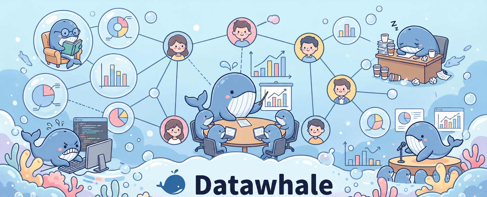
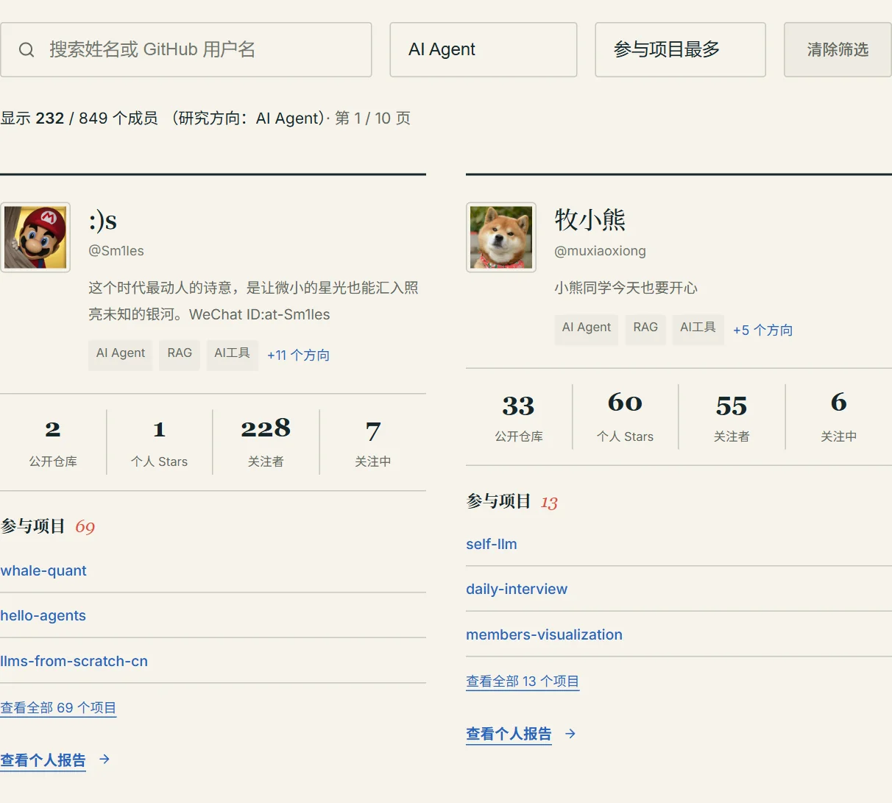
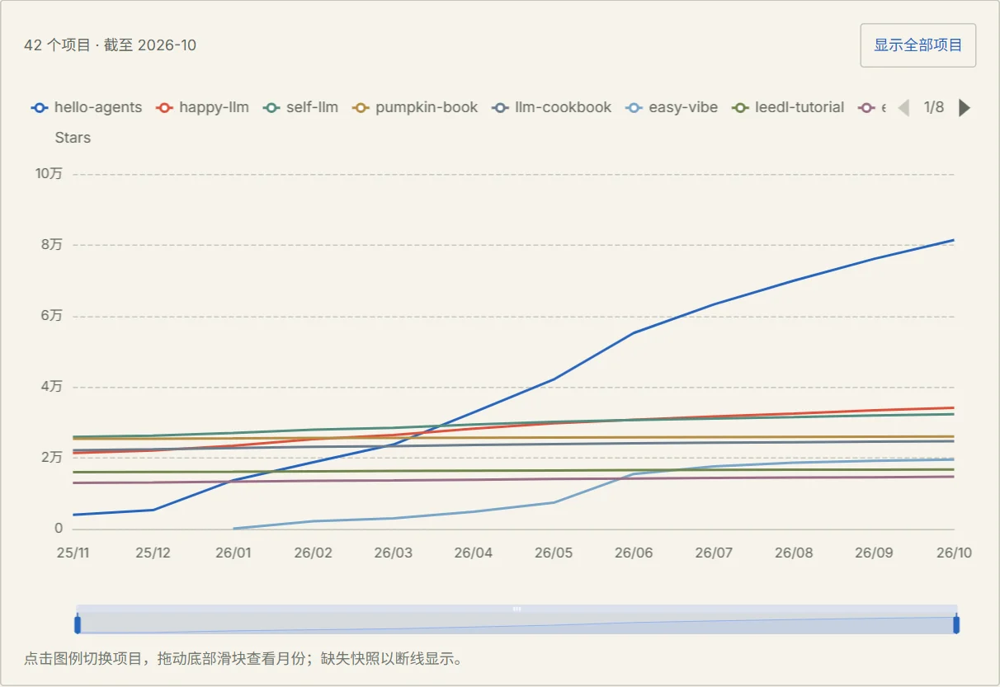
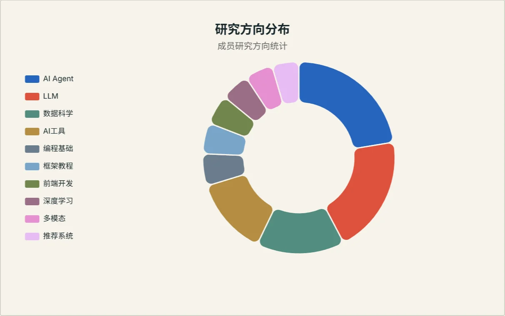
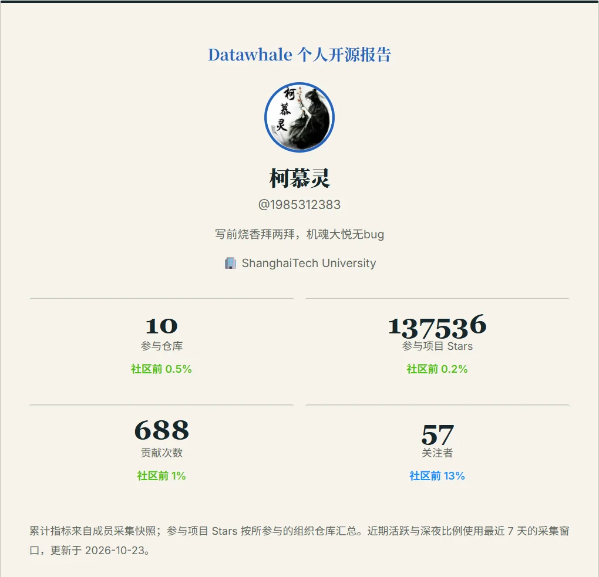
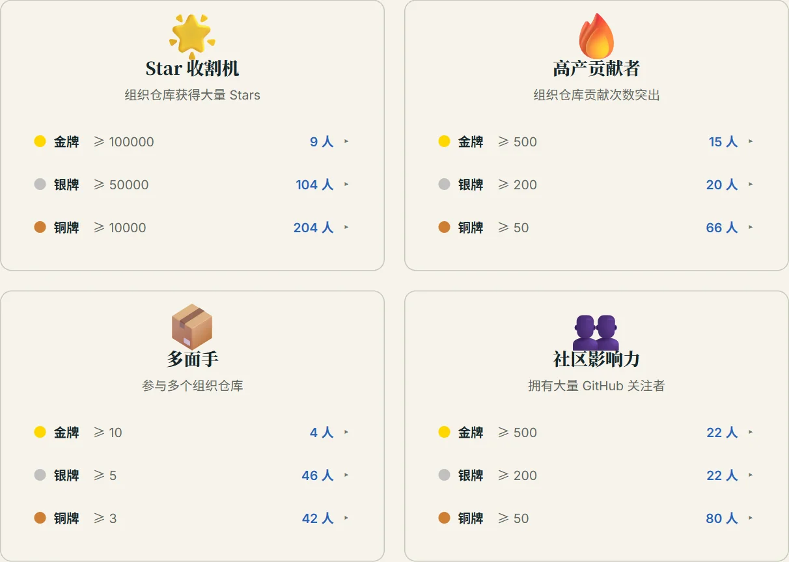
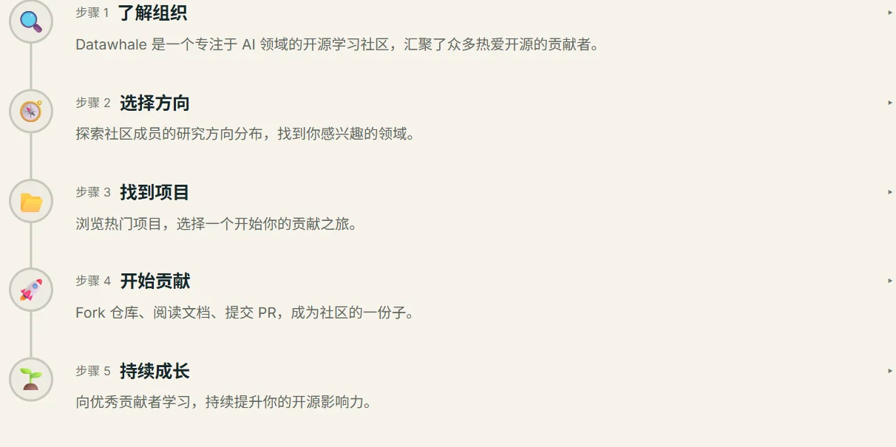
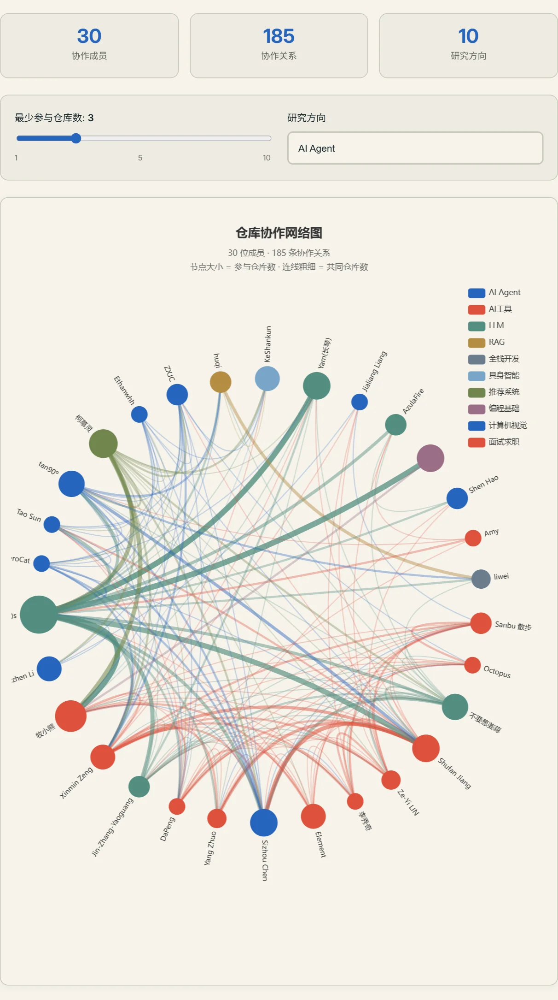

  

<h1 align="center">Datawhale 贡献者可视化</h1>

<strong>看见开源项目背后的人 理解一个社区如何共同成长</strong>

一幅可以探索的开源社区地图

  <a href="https://mv.datawhale.cc/"><strong>在线体验</strong></a> &nbsp; · &nbsp;
  <a href="https://datawhalechina.github.io/members-visualization/">GitHub Pages 镜像</a> &nbsp; · &nbsp;
  <a href="#从这里认识社区">功能预览</a> &nbsp; · &nbsp;
  <a href="https://github.com/datawhalechina/members-visualization/issues">反馈与建议</a>

  

从真实的 GitHub 公开记录出发，认识 Datawhale 的人、项目和共同成长。

## 为什么要有一张社区地图

一份开源教程、一套学习材料、一个持续更新的工具，背后往往有许多人的共同投入。有人发起项目，有人补充内容、修正问题，也有人在长期维护中把项目一点点推进下去。

这些贡献分散在不同的仓库和个人主页里。初次接触社区的人，想找到感兴趣的项目与伙伴；已经参与其中的人，希望回看自己的投入，了解大家正在共同做什么。

**这个项目以 Datawhale 为起点，把贡献者、参与项目、研究方向和时间变化连接起来，让分散的开源记录成为一幅可以探索的社区地图。**

| 让贡献被看见 | 让参与有入口 | 让成长有脉络 |
| :--- | :--- | :--- |
| 从具体的人出发，了解参与项目、贡献记录和阶段成果，认识项目背后的投入。 | 从感兴趣的方向出发，找到项目、认识伙伴，再走向实际的开源贡献。 | 把个人参与、项目变化与社区整体放在一起，观察持续共建怎样发生。 |

> [!TIP]
> **第一次来到这里？** 从[新人引导](https://mv.datawhale.cc/guide)了解社区，或在[贡献者列表](https://mv.datawhale.cc/members)中选择一个感兴趣的研究方向。已经参与过贡献，可以直接生成[个人开源报告](https://mv.datawhale.cc/report)。

## 从这里认识社区

以下为当前版本的真实页面截图，部分展示界面局部。点击图片即可进入对应功能。

<table>
  <tr>
    <td width="50%" valign="top">
      <h3>01 · 认识贡献者</h3>
      
按姓名、GitHub 用户名和研究方向找到伙伴，从他们参与的项目继续探索，也可以查看个人开源报告。

      
      
<a href="https://mv.datawhale.cc/members">探索社区贡献者 →</a>

    </td>
    <td width="50%" valign="top">
      <h3>02 · 发现社区项目</h3>
      
通过月度 Star 快照和净增排行，回看熟悉项目的发展轨迹，发现近期受到关注的项目。

      
      
<a href="https://mv.datawhale.cc/projects">查看项目趋势 →</a>

    </td>
  </tr>
  <tr>
    <td width="50%" valign="top">
      <h3>03 · 理解社区的连接</h3>
      
从研究方向分布、共同参与的仓库和成员关系出发，发现跨项目的联系，探索社区的知识与协作网络。

      
      
<a href="https://mv.datawhale.cc/organization">探索成员与协作分析 →</a>

    </td>
    <td width="50%" valign="top">
      <h3>04 · 留下自己的开源足迹</h3>
      
将已收录成员的参与项目、累计贡献与成就整理为个人报告，支持图片导出和链接分享。

      
      
示例贡献者：<a href="https://mv.datawhale.cc/report?user=1985312383">@1985312383</a>

      
<a href="https://mv.datawhale.cc/report">生成个人报告 →</a>

    </td>
  </tr>
  <tr>
    <td width="50%" valign="top">
      <h3>05 · 看见不同方式的贡献</h3>
      
成就徽章从参与项目、持续贡献和社区影响等侧面呈现成员特点，点击等级还可以认识获得徽章的伙伴。

      
      
<a href="https://mv.datawhale.cc/badges">探索社区成就 →</a>

    </td>
    <td width="50%" valign="top">
      <h3>06 · 开始第一次贡献</h3>
      
从了解组织、选择方向、找到项目，到开始贡献与持续成长，用五个步骤找到自己的参与入口。

      
      
<a href="https://mv.datawhale.cc/guide">开启开源之旅 →</a>

    </td>
  </tr>
</table>

### 仓库协作网络

**从共同参与的项目，认识社区的连接。** 下图为 AI Agent 方向的仓库协作网络：节点表示成员，连线表示共同参与的仓库记录。

  

<strong>继续探索：榜单、阶段成果与项目徽章</strong>

| 你想进一步了解什么 | 可以去哪里 |
| --- | --- |
| 近期有哪些伙伴活跃，大家以哪些方式参与 | [贡献者榜单](https://mv.datawhale.cc/rankings) |
| 回顾一段时间的贡献成果，整理贡献者名单 | [阶段贡献者](https://mv.datawhale.cc/quarterly) |
| 查看社区已经发布的表彰与感谢 | [开源荣誉](https://mv.datawhale.cc/rewards) |
| 从参与者、提交、PR、Issue 与评审等维度观察组织活动 | [OSS Insight 统计](https://mv.datawhale.cc/stats) |
| 把项目趋势和贡献者卡片展示在项目 README 或其他页面 | [项目徽章](https://mv.datawhale.cc/repo-badge) |

## 你可以怎样使用它

| 你的出发点 | 一条可以尝试的路径 |
| --- | --- |
| 对某个方向感兴趣，想找项目和伙伴 | 筛选研究方向 → 认识贡献者 → 查看参与项目 → 回到仓库阅读文档 |
| 已经参与过贡献，想回看或分享经历 | 搜索自己的用户名 → 生成个人报告 → 导出图片或分享链接 |
| 负责维护项目，想了解参与情况 | 浏览项目趋势 → 观察贡献者与协作关系 → 回顾阶段成果 |
| 正在建设其他开源社区，想参考展示方式 | 体验在线站点 → 了解数据含义 → 浏览源码与自动更新流程 |

例如，你对 **AI Agent** 感兴趣，可以先筛选相关方向，看看这些成员参与了哪些项目；找到合适的仓库后，再回到 GitHub 阅读文档、了解问题和贡献约定。随着公开数据被采集，相关参与记录也可以在社区页面中被回看。

<strong>找到方向 → 认识伙伴 → 走进项目 → 留下贡献 → 回看成长</strong>

## 怎样理解这张地图

平台主要依据 **GitHub 公开数据与定期采集的快照** 展示内容，部分组织分析由 OSS Insight 提供。不同页面有各自的统计范围和更新节奏，请结合页面标注的时间理解；README 中的截图用于展示功能，具体数据以在线页面为准。

> [!NOTE]
> **不同指标描述贡献的不同侧面。** 累计贡献、近期活跃和项目关注度有各自的含义；“参与项目 Stars”是所参与组织仓库的关注度汇总，关系图连线来自共同参与仓库的记录。了解具体贡献与合作经历，还需要回到项目记录。

开源中的投入还包括文档打磨、问题解答、代码评审、组织协调和对新人的帮助。榜单、徽章与图表提供了发现贡献的线索，我们也希望读者继续走近这些数字背后的人。

## 一起完善这幅社区地图

- **让记录更准确：** 反馈成员遗漏、研究方向或展示数据的问题，附上相关用户名、项目与页面链接。
- **让参与更容易：** 改善手机端体验、图表交互、介绍文案和新人指引，让更多人找到自己的入口。
- **让社区更容易被理解：** 提出新的观察视角，或参与数据采集、页面组件和自动更新流程的维护。

欢迎通过 [Issue](https://github.com/datawhalechina/members-visualization/issues) 提出建议，或通过 [Pull Request](https://github.com/datawhalechina/members-visualization/pulls) 参与改进。

<strong>开发者入口：在本地运行</strong>

使用 Node.js 22，与项目工作流保持一致。本地可直接使用仓库中已有的数据启动站点：

~~~bash
git clone https://github.com/datawhalechina/members-visualization.git
cd members-visualization
npm ci
npm run docs:dev
~~~

打开终端提示的本地地址，默认是 <http://localhost:5173/members-visualization/>。

构建和预览：

~~~bash
npm run docs:build
npm run docs:preview
~~~

页面位于 [docs](docs/)，数据采集脚本位于 [scripts](scripts/)，自动更新与部署流程见 [GitHub Actions 配置](.github/workflows/)。

重新采集数据需要 Python 和相应的 GitHub API 配置。当前站点围绕 Datawhale 的组织数据构建，迁移到其他社区时，需要同步调整数据源和相关页面配置。

---

<strong>每一份贡献，都是社区共同成长的一部分。</strong>

感谢所有参与 Datawhale 开源项目、维护社区内容，以及帮助这个平台变得更好的伙伴。

